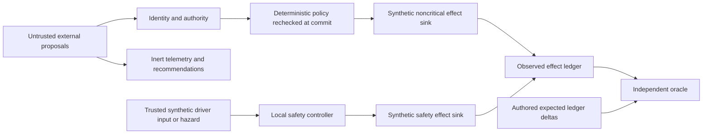

# Ground Truth Vehicle Safety Shield

GT-VSA is an offline WolfTrap experiment in controlling the effects of
untrusted vehicle software and AI proposals. It models remote access to
noncritical functions, protected data and software updates, alongside a separate
local controller for synthetic emergency braking. Every command, credential,
vehicle, firmware descriptor and effect is fictional. The experiment has no
vehicle transports, physical actuators, real sensor feeds or cloud dependency.
The results support claims about the synthetic fixture space only. Vehicle
protection, real-time behavior and regulatory or safety approval remain
unverified.

## Architecture



### 1. Identity and authority

An origin proof and a separately provisioned, opaque ingress handle
authenticate the principal and origin independently of the authority grant.
Trusted fixture wiring supplies the handle outside the request, so copying a
matching signed request and grant onto a different ingress fails. The grant
binds the principal, origin, vehicle, operation, scope and canonical request
digest. A logical clock bounds the grant lifetime. The gateway also checks current
revocation state and the authority epoch. Unavailable or unknown
security state closes the external path. The harness uses distinct synthetic
HMAC keys for origin proofs, authority grants, firmware provenance and ledger
observation. Fixture keys are reproducible and public.

Preparation creates pending work. At commit, the gateway rechecks the origin,
grant, time, epoch, revocation, replay state and policy under the lock used to
commit the protected mutation. An authorization can expire, be revoked, be
abandoned or become ineligible between preparation and commit. A one-time
grant can produce at most one effect under modeled contention. The lock orders
local revocation and commitment. The synthetic trace does not establish the
ordering of physically separate or partitioned systems.

Each vehicle has fixed capacity for pending requests, external effects and
revocations. Saturation closes the affected external path. External and local
effect writers have separate journals with separate capacity and writer locks.
The observer combines their rows in sequence order. If local history exceeds
its retention window, local recording continues and observation reports
insufficient evidence.
The model does not establish restart durability or production request
admission, expiry cleanup and state migration.

### 2. Deterministic security and safety policy

The external gateway exposes a closed set of noncritical operations. An exact
grant is required for each effect. Policy independently limits the diagnostic
and privacy surfaces. Location, camera and microphone data are protected.
Data exports use a narrowly scoped synthetic allowlist. Vehicle telemetry and
agent recommendations are inputs without execution semantics. Infotainment
input cannot expand a grant or enter the safety domain.
The ledger captures export decisions as synthetic effects. It contains no
location coordinates, recordings or outbound transfer of payload bytes.

A firmware manifest uses a dedicated provenance key. The requested update is
bound by the grant, and the simulated policy checks version monotonicity and
trusted operating conditions at commit. An accepted update records a synthetic
version transition. Its target and operating state are controlled by the model.
There is no flash programmer, firmware image execution, or claim of safe
installation on a physical vehicle.

### 3. Independent safety isolation

The external gateway has no route to the local controller. Every external
safety-critical operation is denied, including requests for braking, steering,
acceleration, battery management and ADAS override. The simulated local
controller records a driver-braking effect or an emergency-braking effect when
the corresponding local input meets its condition. Both local entry points
operate without an authority grant or cloud response. The qualification
exercises both paths during cloud disconnection and modeled authority outage
and compromise. The model assumes local input integrity and controller
isolation. Its local controls cover braking.

## Threat model

| Attacker capability or failure | Modeled response | Assumption or unresolved risk |
| --- | --- | --- |
| An untrusted AI agent, cloud service or head unit chooses arbitrary proposals, claims trusted origin, or submits data carrying instructions. | Independently verify origin and grant, require exact bindings, and gate operations with a local deterministic policy. | The gateway's configured trust roots and execution code are trusted in the healthy variant. An attacker with host-code access could bypass process-internal boundaries. |
| An attacker copies a grant or signed request, substitutes an origin credential, changes vehicle or scope, races a duplicate request, or relays a proposal through another agent. | Require the exact origin proof and registered ingress, revalidate before commitment, and serialize replay check and consumption with the effect. | An attacker who controls the enrolled ingress, the matching origin proof and the current grant can be indistinguishable from that principal for the exact authorized noncritical effect. A legitimate principal acting as a willing deputy and independently obtaining fresh authority is a separate approval problem. |
| A compromised authority issues a syntactically valid grant or loses availability. | The noncritical policy and the local safety controller have separate responsibilities. An authority signature alone cannot authorize direct safety commands or satisfy independent firmware provenance. Unavailable authority closes remote effects. | A compromised issuer that can grant a policy-eligible operation to an authenticated principal may enable that effect. Key compromise, revocation convergence and compromise recovery require separate production qualification. |
| A publisher substitutes firmware approval, proposes an older version, or requests a software change in a prohibited state. | Check the dedicated provenance signature, version direction and model-owned operating conditions. | Hardware trust anchors, durable anti-rollback, installed-byte measurement, trusted vehicle signals, recovery and supplier compromise are production concerns. |
| An attacker edits, deletes or fabricates evidence or feeds misleading decision output. | Judge transitions from independently captured effect rows, check evidence integrity, and reproduce the finite campaign at the pinned source. | The witness key and observer share the test process with the simulator. A hostile test runner that controls code and evidence roots is outside the claim. Public fixture keys and report hashes provide reproducibility. Production evidence needs a protected witness and a trusted source pin. |
| Network disruption, service failure, or load on the external path. | Close remote effects when trusted state is unavailable and keep the synthetic local controller callable. Vehicle count and fixture work are bounded. | Availability under resource exhaustion, scheduling jitter, common-cause hardware faults or malicious local sensors remains unverified. |

## Invariants and independent observation

The oracle compares expected and observed protected-effect ledger mutations at
scenario checkpoints. Expected effects are defined in a separate corpus and
cover authorized positive controls. Gateway responses can establish that a
stage was reached. A response claiming success contributes zero effect rows.
The deliberately defective fixtures exercise the oracle with unsafe effects,
lost safety availability and tampered observation data. A qualification
requires both agreement for the healthy model and detection of the designated
defects. A miss by the oracle is a qualification failure.

Snapshots detect ledger prefix changes and wrong, missing or extra rows at the
checkpoints. The assurance assumes this ledger is the only synthetic effect
sink. A bypass that reaches an unobserved sink, or an ephemeral mutation hidden
before a snapshot, needs another observation mechanism.

| Invariant | Evidence criterion |
| --- | --- |
| No current authority means no protected effect. | Missing, expired, wrong-epoch and unavailable authority produce no external ledger mutation. |
| No valid origin binding means no protected effect. | Impersonation, substitution, relay and request changes produce no external ledger mutation. |
| No safety approval means no simulated safety effect. | A synthetic hazard or driver input must meet the local condition before a braking row appears. |
| No external agent has direct safety-control authority. | External safety requests leave the safety ledger unchanged, including attempts with a signed grant. |
| Revoked authority means no new protected effect. | Revocation before preparation or before commitment yields no new protected row. |
| Replayed authorization means no duplicate effect. | A legitimate request commits one exact row, and retries, competing submissions and competing commits produce zero additional rows. |
| Network failure leaves essential local safety available. | An external outage leaves the gateway closed while legitimate local hazard and driver inputs produce their expected safety rows. |
| Verified ≠ authorized. | Valid origin or signature evidence cannot produce a protected effect with missing authority or a policy denial. |
| Authorized ≠ executed. | A successfully prepared request produces no row until a separate, revalidated commit succeeds. |

## Reproduce and interpret the evidence

On Linux with Python 3.11 or later, use a clean WolfTrap checkout and choose
a fresh evidence directory outside it.

```bash
PYTHONPATH=src python -m wolftrap challenge-gt-vsa --output-dir /tmp/gt-vsa --seed 20261117 --vehicles 1024
PYTHONPATH=src python -m wolftrap verify-gt-vsa --evidence-dir /tmp/gt-vsa
PYTHONPATH=src python -m unittest discover -s tests -p 'test_gt_vsa*.py'
```

The full WolfTrap test suite also uses the optional `build-scan` dependency.

`gt-vsa.json` records the source revision, fleet counts, scenario and invariant
results, adaptive trials and defective fixtures. Each scenario records a
representative trial with its ledger effects and a digest over every trial.
The default run uses 1,024 distinct vehicle identities and reinitializes the
vehicle state for each scenario. This is a fleet-sized sample of the same
bounded schedules. The threaded replay control runs within one simulated
vehicle at a time. `gt-vsa.md` is the human-readable index.
`gt-vsa.manifest.json` records the report hashes. The verifier rebuilds the
bounded experiment and compares the evidence. Evidence identifies the source
commit and tree used to generate it.

The adaptive scenarios assess a changed request after a rejection or a limited
diagnostic effect. Their targets are trusted-component impersonation, relay
through a second agent, reuse of safety-related authority, diagnostic
escalation, protected-data export and safety-domain crossover. The oracle can
require a permitted diagnostic mutation and reject any associated privilege
expansion. Each result applies to the chosen fixture sequence and the exact
recorded effects. It gives no estimate for open-ended agent behavior.
The previously valid safety-related authorization in the replay sequence
covers diagnostics. The external authority service has no legitimate direct
actuation grant under this policy.

| Status | Interpretation |
| --- | --- |
| PASS | The independent observation matched the authored synthetic expectation. For a defective fixture, the oracle demonstrated the expected detection. |
| FAIL | The observation reproduced a synthetic security or availability violation, or a required defect escaped detection. |
| BLOCKED | A prerequisite or necessary capability is missing. |
| UNVERIFIED | Available observations are insufficient for the proposed claim. |

Python integrates directly with WolfTrap's `unittest` runner and dependency-free
runtime. Frozen records, explicit state ownership and a bounded synchronization
model make the finite experiment reviewable. Rust would provide stronger type
and memory guarantees for a standalone gateway deployed with a systems runtime.
The production boundary warrants a separate implementation and independent
conformance qualification. No deployed Ground Truth, HERCULES or MobiPute
component participates in the experiment.

## Engineering reference mapping

These references inform the design and its future evidence needs. The mapping
covers selected engineering themes. Type approval, conformity assessments and
any functional-safety certification must be established separately with the
applicable authority and assessment processes.

| Reference | Implemented synthetic controls | Production integration and assurance work |
| --- | --- | --- |
| UN Regulation No. 155 | Explicit threat model, access boundaries, adversarial cases and reproducible effect evidence. | Maintain an OEM cybersecurity management system with risk treatment, supply-chain controls, field monitoring and incident response over the vehicle lifecycle. Determine applicable vehicle type-approval evidence and jurisdiction. [Official published text][r155] |
| UN Regulation No. 156 | Separate firmware provenance, monotonic version checks and simulated operating-condition checks at commit. | Maintain the software update management system, track software and vehicle configurations, establish safe update and recovery behavior, and meet applicable vehicle and software-update type-approval evidence requirements. [Official published text][r156] |
| ISO/SAE 21434 | Authored threat assumptions, trust boundaries and adversarial verification of security goals in a research model. | Perform item-specific threat analysis and risk assessment, trace cybersecurity goals through requirements and validation, and retain a lifecycle cybersecurity case, including supplier and post-production activities. [ISO catalog][iso21434] |
| ISO 26262 | Model independent local braking, check availability during modeled cloud and authority failures, and check separation from external effects. | Perform item definition, hazard analysis and risk assessment, ASIL determination where applicable, safety requirements allocation, dependent-failure analysis, systematic and random-fault evaluation, validation and confirmation measures. [ISO concept phase][iso26262-3] · [ISO system-level development][iso26262-4] |
| NHTSA Cybersecurity Best Practices for the Safety of Modern Vehicles | Application-level segmentation, restricted privilege, controlled updates and witness-based evidence. | Evaluate physical and network architecture, layered defenses, logging and incident response, supplier practices, secure development and validation across the vehicle lifecycle. [NHTSA 2022 guidance][nhtsa] |

## OEM integration roadmap

1. Agree on an item definition, intended vehicle functions, misuse cases, owners
   and authorized evidence boundaries with the OEM. Identify applicable markets,
   vehicle configurations, safety responsibilities and regulatory obligations.
2. Define the interface contract for origin identity, authorization epochs and
   revocation, effect commitments and privacy. HERCULES may govern proposal
   execution upstream. Ground Truth may supply an independent authority decision.
   MobiPute may supply worker provenance as evidence. Each remains outside the
   real-time safety-control loop and unaffiliated with local safety authority.
3. Design OEM-owned gateway and safety-domain boundaries with hardware trust
   anchors, independently provisioned identities, authenticated freshness,
   durable replay state, robust update recovery and a protected effect witness.
   Establish teardown, reset, brownout and multi-ECU consistency requirements
   before any implementation can claim durability.
4. Qualify the contract in software-in-the-loop and OEM-approved simulated
   environments first. Confirm local timing, fail-operational behavior and
   common-cause separation as separate safety engineering tasks under the OEM's
   defined lifecycle and independent review. This public experiment remains
   simulation-only.
5. Have independent reviewers evaluate exact source and released artifacts,
   trace threat and safety requirements to test observations, review supplier
   evidence and confirm operational readiness. Collect the applicable formal
   assessment and type-approval evidence before deployment claims.

[r155]: https://eur-lex.europa.eu/eli/reg/2021/387/oj
[r156]: https://eur-lex.europa.eu/eli/reg/2021/388/oj
[iso21434]: https://www.iso.org/standard/70918.html
[iso26262-3]: https://www.iso.org/standard/68385.html
[iso26262-4]: https://www.iso.org/standard/68386.html
[nhtsa]: https://www.nhtsa.gov/document/cybersecurity-best-practices-safety-modern-vehicles-2022
