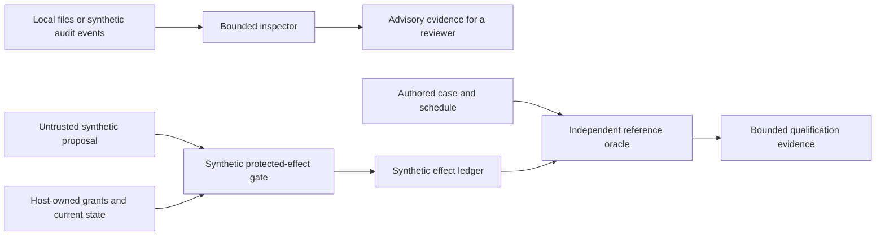

# Security architecture

WolfTrap has two independent paths. Read-only inspectors classify local inputs for reviewer triage. The synthetic research harness tests whether a host gate permits only the intended protected effects under deterministic schedules.

## Inspection path

The GitHub Actions and Dockerfile inspector identifies conditional trust paths. The separate agent-code, protected-effect and prompt-document inspectors flag bounded, recognizable source patterns. The cloud experiments evaluate sanitized event categories and correlation windows. Scope and input contracts vary by command. Ambiguous or unsupported input can result in `INCONCLUSIVE`; a known match is a review signal.

The scanner never runs inspected code or prompts. The inspection report, cloud alert and absence of a match have no authority over protected effects. The community Action runs only the build scanner. Its CI policy decides how to report its outcome and grants no synthetic or runtime permission.

## Authorization path

1. An authored synthetic case supplies trusted host state and specifies a logical event schedule.
2. The system under test verifies synthetic authority and checks that tenant, principal, delegate, origin, scope and operation identity match the request as required by the experiment.
3. Where the experiment models phased execution, the host checks current authority again at the effect boundary. Expiry, revocation, unknown state and replay can prevent an effect even after a prior check passed.
4. The independent oracle constructs expectations from the case and checks observations from the effect ledger. A success message is insufficient evidence of an effect. A legitimate positive control must produce the expected ledger change, alongside negative controls with no forbidden change.
5. Completion manifests bind saved reports to bytes. Replay reconstructs the finite test on a fresh synthetic state and checks the relevant report content.

Agent messages, votes, confidence, tool outputs, and static or event-based alerts are untrusted inputs. The authority-funnel corpus uses inert authority claims to test that boundary. Its host grants and ledger are a model. The single-slot and replay tests demonstrate logical effects under the recorded schedules. Timing behavior, broker cryptography and genuine runtime durability require separate evidence.

## Evidence boundary

The inspectors begin with explicit local input. The public experiments use fictional aliases, synthetic credentials or grant state, and disposable effect records. The authority experiments have no dependency on Ground Truth, HERCULES, MobiPute or TruthPute. See [evidence qualification](evidence-guide.md) and the [proposed private conformance contract](private-runtime-conformance.md).
